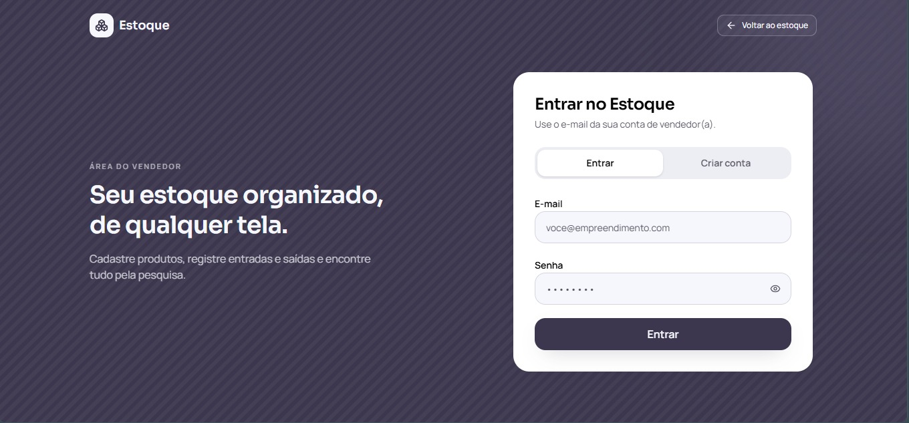
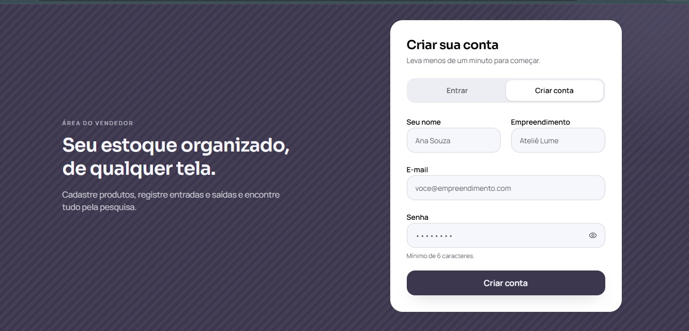
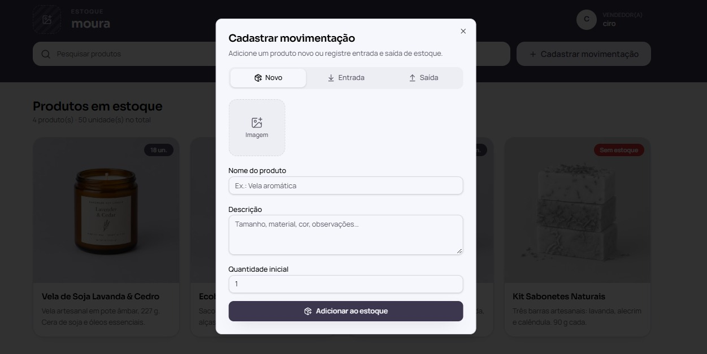
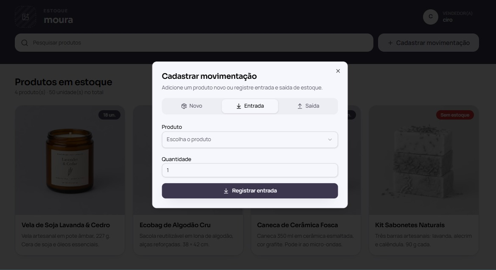
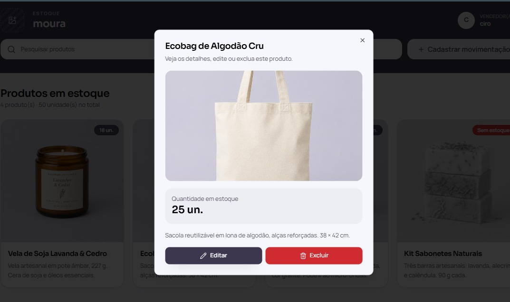

# StockFlow
## 👥 Integrantes
- Francisco Luan
- Laize Samilly da Silva Nobre
- Lucas Gabriel Feitosa Pereira
- Samuel Lucas dos Santos Oliveira
 
 

## 🛣️ Trilha escolhida
A trilha escolhida foi uma ideia personalizada. Isto é, não foi nada sugerido pelo professor Jeferson. O projeto StockFlow é um estoque online, onde os vendedores utilizarão.
 
 

## 🔧 Qual problema isto resolve?
É comum de quase todos os participantes a presença de parentes próximos que trabalham com vendas de produtos, e todos eles apresentam um problema similar: a dificuldade em organizar o estoque. Isso gera confusão no cliente e dificuldade em saber quais produtos repôr no estoque, quais não estão saindo e outras dficuldades.
 

Pensando nisso que nasceu o StockFlow, uma aplicação onde o vendedor consegue gerenciar a saída, entrada e registro de seus produtos com alguns cliques, facilitando o trabalho e melhorando sua eficiência
 
 

## 🧩 Protótipo
A seguir, imagens do protótipo do site. O design de como ele deve ser desenvolvido:
 

.jpeg)

.jpeg)

[visualize o protótipo navegável aqui](https://lovable.dev/projects/d76ae399-c2f8-54c6-9e74-bb7cd8051c86?magic_link=mc_2d8ff31e-4853-48a6-9c9b-d80e73a173ad)
 
 

## 🛢️ Modelagem do banco de dados
A seguir, o modelo do nosso banco de dados relacional:
 

 
 

## 🤖 Qual foi o uso de IA?
### Ferramenta usada
Nós utilizamos do Lovable, uma ferramenta de IA que auxiliou na criação do nosso protótipo navegável

### Prompts
#### 1º prompt:
"Eu gostaria de uma aplicação de estoque (para pc e responsivo) que apresentasse na tela inicial : um cabeçalho com login de vendedor e nome do empreendimento, um canto destinado a logo; uma barra de pesquisa e um botão de "cadastrar movimentação". abaixo os produtos cadastrados pelo vendedor, teremos os produtos que já foram adicionados ao estoque com nome, imagem e campo de descrição. Cores #3c374e e #f6f7fc e #000000;"

#### 2º prompt:
"Adicione uma página de login/cadastro parecida com essa, mas que se adeque a nossa estética do estoque. Ela pode ser acessada pelo perfil do vendedor;"

#### 3º prompt:
"O CRUD de produto nosso inclui a opção de excluir e de editar o produto, além da de cadastrar o produto que já está em movimentação. Faça com que ao clicar em algum dos produtos da listagem, apareça botões de editar e excluir (e confirmação de exclusão) bem como os campos necessários para as ações"

### O que das nossas ideias se manteve?
Como é possíve ver, todas as ideias foram nossas, e todas elas se manteram. O trabalho da IA foi apenas dar vida às nossas ideias, decorando e casando elas de forma harmônica

### Como ficou após a IA?
Após a IA, temos o protótipo harmonizado e com as combinações entre elementos e cores.